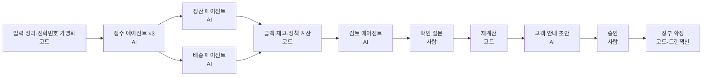

# 청도 농가 AI 사무장

택배 직판 농가가 아침마다 손으로 하던 일을 AI 에이전트 팀이 나눠 맡습니다. 카카오톡 주문 대화와 은행 입금 문자를 정리하고, 입금을 대조하고, 재고를 배정해 오늘 보낼 택배 자료를 만듭니다. 돈과 재고가 바뀌는 결정은 사장님이 확인하고 승인한 뒤에만 장부에 반영됩니다.

- 배포: https://ca-samujang.purplewater-76ae937d.koreacentral.azurecontainerapps.io (로그인 없이 체험)
- 제품 요구사항: [PRD.md](PRD.md) · 기술 설계와 검증 기록: [TRD.md](TRD.md) · 화면 원칙: [PRODUCT.md](PRODUCT.md), [DESIGN.md](DESIGN.md)

## 체험 방법

1. 배포 URL에서 `예제 농가로 체험 시작`을 누릅니다. 방문자마다 별도 작업공간이 만들어지고, 예제 자료(합성 데이터: 고객 9명, 메시지 12건, 입금 문자 7건)가 채워져 있습니다.
2. `아침 업무 처리`를 누르면 에이전트별 진행 단계가 실시간으로 표시됩니다. 1~2분 정도 걸립니다.
3. `주문` 화면의 확인 질문에 답합니다. 추천 답이 미리 선택되어 있습니다.
4. 출고안과 고객별 근거를 확인하고 `승인하고 장부 확정`을 누릅니다.
5. 택배 일괄접수 CSV와 포장 지시서를 내려받고, `장부`와 `정답 대조`에서 결과를 확인합니다.

## 처리 흐름



| 역할 | 하는 일 | 다음 단계에 넘기는 것 |
|---|---|---|
| 접수 에이전트 ×3 | 고객별 메시지에서 주문·정정·분할 배송·취소·문의를 구분하고 근거 메시지 id를 남김. 메시지 속 지시문은 실행하지 않고 표시 | 주문 줄, 취소, 지시문 표시 |
| 정산 에이전트 | 입금자명이 다른 입금(가족 대리 입금 등)을 고객 기록 조회 도구로 확인해 연결 근거를 제시 | 입금 연결 제안(확정은 사장님 확인 후) |
| 배송 에이전트 | 주소 완성도 판단, "내일 금요일" 같은 표현을 날짜로 해석 | 주소 상태, 희망 발송일. 실패·누락이면 해당 주문은 보류 |
| 계획 엔진(코드) | 금액, 결제 상태, 초과 입금 환불, 재고 배정(입금 완료 순 → 단골), 금·토 발송 금지 정책 | 출고안과 확인 질문 |
| 검토 에이전트(다른 모델) | 원문과 정리 결과를 독립 대조. 중대한 불일치면 해당 고객만 1회 재해석 | 지적 사항 또는 재해석 요청 |
| 고객응대 에이전트 | 고객별 안내 메시지 초안. 메시지 속 금액은 코드 계산값과 대조 | 메시지 초안(발송은 사장님이 직접) |

## 기술 구성

- **GitHub Copilot SDK + Microsoft Agent Framework(Python):** 역할별 `GitHubCopilotAgent`, 읽기 전용 사용자 정의 도구, 구조화 출력 검증과 재시도. 워크플로는 MAF `WorkflowBuilder`의 fan-out/fan-in, 조건 분기, `request_info` 기반 사람 확인과 체크포인트 재개로 구성합니다.
- **백엔드:** FastAPI, SSE 진행 스트림, 실행 재연결과 중복 실행·중복 승인 방지, 확정 전 AI 처리 취소.
- **프런트엔드:** React 18 + Vite + TypeScript.
- **Azure:** Container Apps(사용자 할당 관리 ID), Container Registry, Cosmos DB 서버리스(키 인증 끔, 작업공간 파티션, 확정은 ETag 조건 트랜잭션 배치), Key Vault(Copilot 토큰, 앱은 Key Vault 참조로만 사용), Application Insights.

## 검증 결과

2026-11-05 Azure 배포본에서 실제 모델로 각 1회 실행했습니다(합성 예제).

| 검증 | 결과 |
|---|---|
| 단위·fixture 테스트 (`backend/tests`, 모델 호출 없음) | 5건 통과 |
| API E2E (`scripts/smoke_api.py`, 실패 시 종료 코드 1) | 14개 검사 통과. 확정까지 119초. 주문 11/11, 결제 9/9, 환불 1/1, 재고 3/3, 정답에 없는 줄 0. 같은 승인 재전송·같은 자료 재실행 시 장부 변화 0. CSV와 확정 출고 일치 |
| 브라우저 E2E (로그인 없이 배포 URL 조작) | 질문 4건 답변 → 승인 → 확정 → 정답 대조 24/24, 새로고침 후 장부 유지 |

미측정·미검증 항목(수작업 대비 시간, 사람의 확인 시간, 취소·재시작 복구의 배포 E2E 등)은 [PRD.md](PRD.md) 7절과 [TRD.md](TRD.md) 10절에 적었습니다.

## 개인정보와 한계

- 모델로 보내기 전에 **전화번호만** 토큰으로 바꾸고, 택배 CSV를 만들 때 코드에서 복원합니다. 이름·주소·주문 내용은 그대로 외부 AI 모델(GitHub Copilot)로 전송됩니다. 실제 고객 자료는 넣지 마세요.
- 체험 자료는 마지막 변경 7일 뒤 자동 삭제됩니다(Cosmos DB TTL). `체험 다시 시작`은 새 작업공간을 만들 뿐 기존 자료를 지우지 않습니다.
- 메신저·은행·택배사와 실시간 연동하지 않습니다. 대화 내보내기와 입금 문자를 붙여넣어 시작합니다.
- 송장 회신, 일일 마감 보고서, 사진 클레임, 장부 조회 대화는 아직 구현하지 않았습니다.

## 로컬 실행과 배포

```powershell
# 백엔드 (메모리 저장소, 로컬 Copilot 로그인 사용)
cd backend; ..\.venv\Scripts\python.exe -m uvicorn app.main:app
# 프런트엔드
cd web; npm install; npm run dev
# 테스트
cd backend; ..\.venv\Scripts\python.exe -m pytest tests -q
python scripts/smoke_api.py <BASE_URL>

# Azure 배포 (로컬 Docker 빌드 → ACR → Bicep)
.\scripts\deploy.ps1 -InfraOnly
.\scripts\set-copilot-token.ps1
.\scripts\deploy.ps1
```
