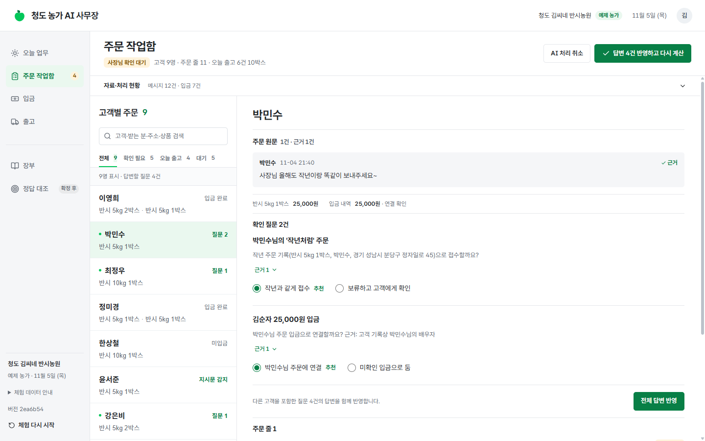
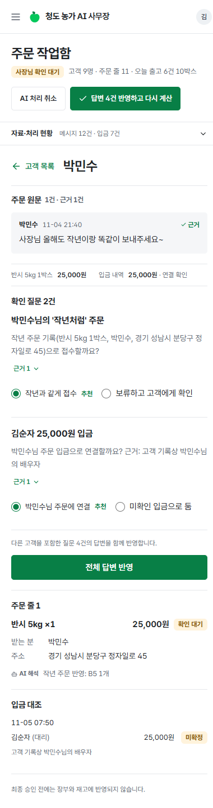
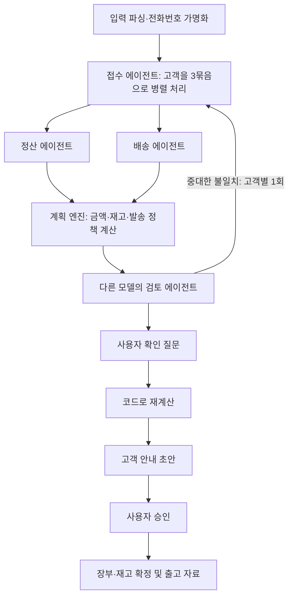

# 청도 농가 AI 사무장

**흩어진 주문 대화와 입금 문자를, 확인하고 승인할 수 있는 오늘의 출고안으로.**

택배로 농산물을 직접 판매하는 농가를 위한 업무 앱입니다. 카카오톡 주문 대화와 은행 입금 문자를 넣으면 AI 에이전트가 주문 변경·취소·배송 요청을 정리하고, 입금을 대조합니다. 사용자가 확인 질문에 답하고 출고안을 승인하면 장부와 재고가 함께 확정되고 택배 CSV와 포장 지시서를 받을 수 있습니다.

[화면 보기](#주문-작업함) · [로컬 실행](#로컬-실행) · [제품 요구사항](PRD.md) · [기술 설계·검증 기록](TRD.md)

해커톤 종료 후 2026년 11월 6일 Azure 공개 데모 운영을 종료했습니다. 화면과 검증 기록은 이 저장소에 보관하며, 아래 안내로 로컬에서 실행할 수 있습니다.

## 수상

**2026 청도 바이브코딩 해커톤 · 대구한의대학교 총장상 수상**

“생산성 향상 앱 개발”을 주제로 GitHub Copilot SDK, Microsoft Agent Framework, Azure를 활용해 개발했습니다.

## 어떤 일을 돕나요?

주문 한 건은 한 메시지로 끝나지 않습니다. “아까 2박스 말고 3박스요”, “1박스는 언니네로요”, “남편 이름으로 입금했어요” 같은 대화가 이어지면 주문 수량, 배송지, 입금을 함께 다시 확인해야 합니다.

AI 사무장은 이 과정을 **원문 근거가 있는 주문 정리 → 입금·재고 확인 → 사람의 승인 → 출고 자료**로 연결합니다.

| 들어오는 상황 | 앱에서 하는 일 |
|---|---|
| 주문 뒤에 수량 변경·일부 취소·분할 배송 요청이 이어짐 | 고객별 최종 주문을 정리하고 판단에 사용한 메시지를 연결합니다. |
| 주문자와 입금자 이름이 다르거나 입금액이 부족·초과함 | 고객 기록을 조회해 연결 후보를 제시하고, 금액은 코드로 계산합니다. 불확실한 연결은 사용자에게 묻습니다. |
| 재고가 부족하거나 주소·발송일 확인이 필요함 | 입금 완료 시각·단골 여부 등 정책으로 재고를 배정하고, 확정할 수 없는 주문은 질문 또는 보류로 남깁니다. |
| 출고안을 확인함 | 승인 후 장부·재고를 함께 반영하고 택배 CSV, 포장 지시서, 고객 안내 초안을 제공합니다. |

현재 구현 범위는 **아침 주문 정리부터 출고 확정까지**입니다. 실제 농가에서의 사용성이나 시간 절감 효과는 아직 검증하지 않았습니다.

## 주문 작업함

아래는 해커톤 이후 리디자인한 로컬 실행 화면입니다.

[리디자인 검증 기록](docs/REDESIGN_QA.md): 실제 API와 연결한 합성 예제에서 승인·장부·CSV 다운로드와 24/24 정답 대조를 확인했습니다.

고객별 목록에서 확인할 주문을 고르면, 상세에서 **원문 메시지·주문·입금·확인 질문**을 함께 볼 수 있습니다. 데스크톱은 목록과 상세를 나란히 배치하고, 모바일은 목록에서 고객을 선택해 상세로 이동합니다. 흰 바탕과 초록 강조색, 짧은 한글 업무명을 중심으로 구성했습니다.



<details>
<summary>모바일 주문 작업함 보기</summary>

<p></p>

</details>

## 로컬 예제 체험

[로컬 실행](#로컬-실행) 절차로 앱을 시작한 뒤 합성 예제로 전체 흐름을 체험할 수 있습니다. 앱의 회원가입은 필요하지 않으며, 모델 호출에는 본인의 GitHub Copilot 인증이 필요합니다.

1. <http://localhost:5173>에서 `예제 농가로 체험 시작`을 누릅니다. 고객 9명, 메시지 12건, 입금 문자 7건이 준비되어 있습니다.
2. `아침 업무 처리`를 누르고 에이전트별 진행 상황을 확인합니다. 기존 측정에서는 약 1~3분이 걸렸으며, 모델 응답 상황에 따라 달라집니다.
3. `주문 작업함`의 고객 목록에서 확인할 주문을 고릅니다. 상세에서 원문·주문·입금을 비교하고 확인 질문에 답합니다. 예제에는 추천 답이 미리 선택되어 있습니다.
4. 출고안·입금 연결·환불 예정액을 검토한 뒤 `승인하고 장부 확정`을 누릅니다.
5. `출고`에서 택배 CSV와 포장 지시서를 받고, `장부`와 `정답 대조`에서 확정 결과를 확인합니다.

고객 안내는 초안으로 제공하며 자동 발송하지 않습니다. 환불 예정액도 장부에 기록할 뿐 실제 송금은 실행하지 않습니다. 데모에는 실제 고객 자료를 입력하지 마세요.

## 기술 설계

### 해석·계산·승인의 책임을 나눴습니다

AI는 대화의 의미와 근거를 해석합니다. 금액·입금 상태·재고·발송 정책은 Python 코드가 계산합니다. 장부와 재고를 바꾸는 최종 결정은 사용자가 승인합니다.



| 설계 | 구현과 목적 |
|---|---|
| 역할별 에이전트와 업무 그래프 | `GitHubCopilotAgent`를 접수·정산·배송·검토·고객응대 역할로 구성합니다. MAF `WorkflowBuilder`가 병렬 처리, 조건 분기, 재해석, 사람 확인 단계를 연결합니다. |
| 구조화된 결과와 권한 제한 | Pydantic 스키마로 출력을 검증하고 형식 오류 시 1회 재요청합니다. 에이전트에는 상품·고객 기록 등 읽기 도구만 허용하고 셸·파일·URL 접근 권한은 거부합니다. |
| 확인과 승인에서 중단·재개 | MAF `request_info`와 체크포인트를 사용합니다. SSE로 진행 상황을 전달하며, 화면 이동·재연결과 확정 전 AI 처리 취소를 지원합니다. |
| 중복 반영과 동시 수정 방지 | Cosmos DB의 작업공간 ETag 조건과 확정 표식을 하나의 트랜잭션 배치로 처리합니다. 확정한 원천 자료의 지문을 저장해 같은 승인·자료의 재반영을 막습니다. |
| 불확실한 결과는 보류 | 주소·배송 검증 실패나 모호한 입금 연결을 정상 처리로 간주하지 않고 질문으로 남깁니다. 고객 안내 초안의 금액도 코드 계산값과 대조합니다. |

### 구성

| 계층 | 사용 기술 |
|---|---|
| 화면 | React 18, TypeScript, Vite, 일반 CSS, Lucide, Pretendard |
| API·업무 로직 | Python, FastAPI, SSE, Pydantic |
| AI 실행 | GitHub Copilot SDK, Microsoft Agent Framework |
| 실행·이미지 | Azure Container Apps, Container Registry, Docker |
| 저장·인증 | Cosmos DB 서버리스, 사용자 할당 관리 ID, Key Vault |
| 관찰·배포 | Application Insights, Log Analytics, Bicep, PowerShell |

실제 앱은 **Python용 Copilot SDK**를 사용합니다. 루트 `package.json`의 Node용 `@github/copilot-sdk`는 초기 환경 확인용이며 앱 런타임에는 사용하지 않습니다. 상세 구현은 [TRD.md](TRD.md)에 정리했습니다.

## 로컬 실행

아래 명령은 **Windows PowerShell 7, Python 3.12, Node.js 22** 기준입니다. Git과 GitHub Copilot 사용 권한이 필요합니다. 기본 로컬 저장소는 메모리이며, 백엔드를 종료하면 작업공간과 장부가 사라집니다.

### 1. 저장소와 의존성 준비

```powershell
git clone https://github.com/PLZGET/cheongdo-ai-samujang.git
Set-Location .\cheongdo-ai-samujang

py -3.12 -m venv .venv
.\.venv\Scripts\python.exe -m pip install -r .\backend\requirements.txt
npm --prefix web ci
```

### 2. Copilot 인증

로컬에서는 Copilot CLI의 로그인 정보를 사용합니다. CLI를 설치한 뒤 실행하고, CLI 안에서 `/login` 안내에 따라 로그인합니다. 로그인 후 CLI를 종료하고 다음 단계로 진행합니다. 설치·인증 방식은 [GitHub 공식 안내](https://docs.github.com/en/copilot/how-tos/copilot-cli/set-up-copilot-cli/install-copilot-cli)를 따릅니다.

```powershell
npm install -g @github/copilot
copilot
```

앱은 `COPILOT_GITHUB_TOKEN`이 설정되어 있으면 해당 토큰을 우선 사용합니다. 기본 모델은 `claude-haiku-4.5`와 검토용 `claude-sonnet-5`이며, 계정에서 사용할 수 있는 모델에 맞춰 `MODEL_FAST`, `MODEL_REVIEW` 환경변수로 바꿀 수 있습니다. [SDK 인증 문서](https://github.com/github/copilot-sdk/blob/main/docs/auth/authenticate.md)

### 3. 백엔드와 화면 시작

저장소 루트에서 터미널 두 개를 열고 각각 실행합니다.

**터미널 A — 백엔드**

```powershell
.\.venv\Scripts\python.exe -m uvicorn app.main:app --app-dir backend --host 127.0.0.1 --port 8000
```

**터미널 B — 프런트엔드**

```powershell
npm --prefix web run dev
```

브라우저에서 <http://localhost:5173>에 접속합니다. Vite가 `/api` 요청을 로컬 백엔드로 전달합니다. <http://127.0.0.1:8000/api/health>에서는 런타임 준비 상태와 저장소 종류를 확인할 수 있습니다. `copilot: ready`는 런타임 시작 상태이며 실제 모델 호출 성공까지 보장하는 값은 아닙니다.

### 4. 테스트와 빌드

모든 명령은 저장소 루트에서 시작합니다. `pytest`는 실행 의존성과 별도로 설치합니다.

```powershell
.\.venv\Scripts\python.exe -m pip install pytest
Push-Location .\backend
..\.venv\Scripts\python.exe -m pytest tests -q
Pop-Location

npm --prefix web run build
```

API 전체 흐름 검사는 실행 중인 백엔드와 실제 Copilot 모델을 사용합니다. 새 예제 작업공간을 만들고 질문 응답·승인·정답 대조·중복 처리·CSV를 검사하며, 검사 실패 시 종료 코드 1을 반환합니다.

```powershell
.\.venv\Scripts\python.exe .\scripts\smoke_api.py http://127.0.0.1:8000
```

## Azure 배포

Azure CLI, 실행 중인 Docker Desktop의 Linux 컨테이너 엔진, Azure 리소스와 역할 할당을 생성할 수 있는 권한이 필요합니다. 배포하면 Azure 사용 비용이 발생합니다.

저장소 루트에서 Azure에 로그인하고 대상 구독을 확인한 뒤 실행합니다. 아래 리소스 그룹 이름은 자신의 배포 환경에 맞게 지정합니다.

```powershell
az login
$samujangResourceGroup = "rg-samujang-demo"
az group create --name $samujangResourceGroup --location koreacentral

.\scripts\deploy.ps1 -ResourceGroup $samujangResourceGroup -InfraOnly
.\scripts\set-copilot-token.ps1 -ResourceGroup $samujangResourceGroup
.\scripts\deploy.ps1 -ResourceGroup $samujangResourceGroup
```

토큰 등록 스크립트가 `Copilot Requests` 권한이 있는 GitHub fine-grained 토큰을 입력받아 Key Vault에 저장합니다. 배포 스크립트는 로컬 Docker로 이미지를 빌드하고 ACR에 푸시한 뒤 Bicep으로 Container Apps를 갱신합니다. 이미지 태그와 `/api/health`의 `version`에 Git 커밋을 기록합니다. 리소스 구성과 제약은 [TRD.md](TRD.md)의 Azure 구성·배포 항목을 참고하세요.

## 검증 기록과 한계

아래 결과는 **[PRD.md](PRD.md)·[TRD.md](TRD.md)에 남아 있는 기존 실행 기록**입니다. 실제 모델 검사는 2026-11-05 Azure 배포본 `1f921c9`에서 **합성 예제로 API·브라우저 각각 1회** 수행한 결과이며, 현재 버전의 반복 검증 결과나 일반적인 정확도를 의미하지 않습니다.

| 검증 범위 | 기록된 결과 |
|---|---|
| 단위·fixture 테스트 — 모델 호출 없음 | 계획 엔진, 가족 대리 입금 후보, 배송 검증 실패 보류, 원천 자료 재반영 방지 등 5건 통과 |
| API E2E — 실제 모델 | 14개 검사 통과. 질문 표시 93초, 장부 확정 119초. 같은 승인 재전송·같은 자료 새 실행 후 장부·재고 변화 없음. CSV 8줄·13박스와 확정 출고 일치 |
| 브라우저 E2E — 실제 모델 | 확인 질문 → 승인 → 장부 → 정답 대조 **24/24**. 주문 줄 11/11, 결제 9/9, 환불 1/1, 재고 3/3. 새로고침 후 장부 유지 |

- **생산성:** 실제 농가 사용자 검증, 수작업 대비 시간, 사람이 근거를 읽고 승인하는 시간은 측정하지 않았습니다. 시간 절감률이나 실사용 성과를 주장하지 않습니다.
- **신뢰성:** 같은 입력에서도 모델 결과와 질문 수가 달라질 수 있습니다. 여러 번 반복한 일치율, 취소·장부 충돌·서버 재시작·통신 단절 등 예외 상황의 배포 E2E는 위 기록에서 검증되지 않았습니다.
- **연동·기능 범위:** 메신저·은행·택배사 실시간 연동, 자동 메시지 발송·송금은 제공하지 않습니다. 송장 회신, 일일 마감, 사진 클레임, 장부 조회 대화, 수확량 변동에 따른 재계획은 미구현입니다.
- **입금·재처리 범위:** 하나의 입금을 여러 고객에게 나눠 배분하는 기능은 없습니다. 확정 때 보류된 주문의 원문도 처리된 자료로 기록되므로, 이후 재처리에는 고객의 새 메시지가 필요합니다.

### 개인정보와 보관

모델에 전달하기 전에 **전화번호만** 토큰으로 바꾸고 CSV 생성 때 복원합니다. **이름·주소·주문 내용은 외부 AI 모델인 GitHub Copilot로 전송됩니다.** 예제를 수정한 자료를 실행할 때 화면에서 이 범위를 확인받습니다.

해커톤 Azure 배포본에는 Cosmos DB 문서의 마지막 변경 후 7일 만료 정책을 적용했습니다. 기본 로컬 실행은 메모리 저장소를 사용하며 백엔드를 종료하면 자료가 사라집니다. `체험 다시 시작`은 새 작업공간을 만들며 기존 자료를 즉시 삭제하지 않습니다. 즉시 삭제 기능은 아직 없습니다.

## 코드와 문서 안내

| 위치 | 내용 |
|---|---|
| [web/src](web/src) | 오늘 업무·주문·입금·출고·장부·정답 대조 화면 |
| [backend/app/agents.py](backend/app/agents.py) | Copilot 런타임, 역할별 지침·도구·출력 스키마 |
| [backend/app/morning.py](backend/app/morning.py) · [domain.py](backend/app/domain.py) | 아침 업무 그래프와 금액·재고·정책 계산 |
| [backend/app/store.py](backend/app/store.py) | 메모리·Cosmos DB 저장소, 체크포인트와 확정 처리 |
| [backend/tests](backend/tests) · [scripts/smoke_api.py](scripts/smoke_api.py) | 모델 없는 단위 테스트와 실제 모델 API E2E |
| [infra/main.bicep](infra/main.bicep) · [scripts/deploy.ps1](scripts/deploy.ps1) | Azure 리소스와 배포 절차 |
| [PRD.md](PRD.md) · [TRD.md](TRD.md) | 요구사항, 구현 상태, 설계 결정, 측정 조건·결과 |
| [PRODUCT.md](PRODUCT.md) · [DESIGN.md](DESIGN.md) | 대상 사용자, 제품 범위, 화면·디자인 원칙 |
