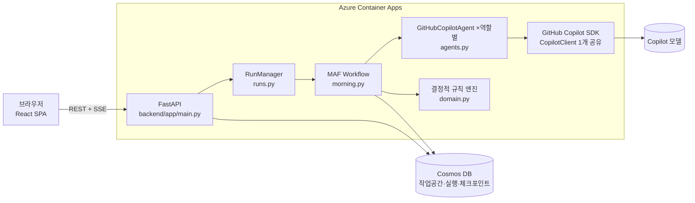
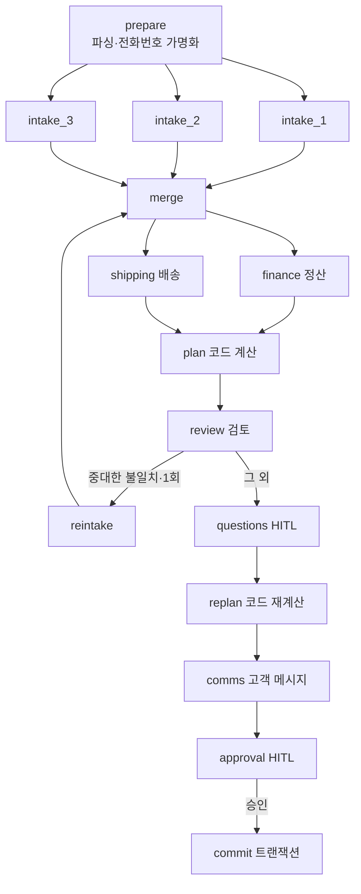

# TRD — 청도 농가 AI 사무장

> 기술 설계의 기준 문서다. 각 항목의 상태는 실제 코드·배포 기준으로 표시한다.
>
> 상태 표기: ✅ 구현·검증 완료 / 🟡 구현됨·검증 진행 중 / ⏳ 계획(미구현)

## 1. 구성 개요



| 계층 | 기술 | 위치 |
|---|---|---|
| 화면 | React 18 + Vite + TypeScript, Pretendard, lucide | `web/src` |
| API | FastAPI, SSE(`text/event-stream`) | `backend/app/main.py` |
| 에이전트 오케스트레이션 | Microsoft Agent Framework `agent-framework-core` 1.24 (Workflow, Executor, fan-out/fan-in, 조건 분기, `request_info` HITL, 체크포인트) | `backend/app/morning.py`, `runs.py` |
| 모델 연결 | `agent-framework-github-copilot` 2.1.1의 `GitHubCopilotAgent` + `github-copilot-sdk` 1.0.28 `CopilotClient` | `backend/app/agents.py` |
| 업무 규칙 | 순수 Python (금액, 입금 정산, 재고 배정, 발송 정책, 환불) | `backend/app/domain.py` |
| 저장 | Azure Cosmos DB for NoSQL (서버리스), 로컬은 메모리 | `backend/app/store.py` |
| 배포 | Bicep, Docker 이미지(커밋 해시 태그) → ACR → Container Apps | `infra/main.bicep`, `scripts/deploy.ps1`, `Dockerfile` |

루트의 `package.json`(Node용 `@github/copilot-sdk`)은 초기 환경 확인용이며 런타임에서 쓰지 않는다. MAF의 Copilot 통합은 Python·.NET에서 제공되므로 백엔드는 Python으로 구현했다.

## 2. GitHub Copilot SDK와 Microsoft Agent Framework 사용 방식

| 기능 | 구현 | 상태 |
|---|---|---|
| 모델 연결 | 앱 시작 시 `CopilotClient` 1개를 띄우고 모든 에이전트가 공유한다(`CopilotRuntime`). Azure에서는 Key Vault에 저장된 GitHub 토큰을 `github_token`으로 넘기고 `use_logged_in_user=False`로 둔다 | 🟡 |
| 에이전트 정의 | 역할별 `GitHubCopilotAgent`: 접수·정산·배송·검토·고객응대·클레임·장부 조회. 역할마다 지침(`INSTRUCTIONS`)과 도구 집합(`TOOLS`)이 다르다 | ✅ |
| 도구 호출 | 읽기 전용 함수 도구(`get_catalog`, `get_customer_profile`, `get_customer_ledger`, `get_ledger_summary`). 작업공간 데이터는 `FunctionInvocationContext.kwargs`로 주입해 모델 입력 스키마에 노출하지 않는다 | ✅ |
| 권한 경계 | 세션마다 `available_tools`를 역할 도구로 제한하고, `on_permission_request`가 등록된 사용자 정의 도구만 승인한다. 셸·파일·URL 등 런타임 내장 권한은 모두 거부한다 | ✅ |
| 구조화 출력 | 역할별 Pydantic 스키마로 검증하고, 형식이 틀리면 오류 내용을 붙여 1회 재요청한다(`run_structured`) | ✅ |
| 오케스트레이션 | `WorkflowBuilder` 그래프(아래 3절). 병렬 fan-out/fan-in, 조건 분기, 재작업 루프, 사람 확인 2회 | ✅ |
| 사람 확인(HITL) | `ctx.request_info` → 실행 중단 → 체크포인트 저장 → `/respond` 요청 시 `workflow.run(checkpoint_id=…, responses=…)`로 재개 | ✅ |
| 체크포인트 | `StoreCheckpointStorage`가 MAF 체크포인트를 Cosmos DB 작업공간 파티션에 저장한다. 앱 재시작 뒤에도 대기 중인 실행을 재개할 수 있다 | 🟡 |
| 스트리밍 | 워크플로 이벤트 스트림과 실행 단계별 진행 이벤트를 SSE로 브라우저에 실시간 전달한다 | ✅ |
| 컨텍스트 | 고객별 메시지 묶음과 시간순 정정 이력, 작년 주문·가족 관계 조회, 검토 지적을 다음 재해석 프롬프트에 포함 | ✅ |
| 이미지 입력 | MAF `Content.from_uri(data:image/...)` → Copilot SDK blob 첨부로 사진 판독. 스파이크로 확인했고 앱 기능은 미구현 | ⏳ |
| 관찰성 | `enable_instrumentation(enable_sensitive_data=False)` + Azure Monitor OpenTelemetry. 프롬프트·응답 본문은 추적에 남기지 않는다 | 🟡 |

검증 근거: `spikes/spike_maf_copilot.py`(실제 모델 응답, 도구 호출, 스트리밍, 병렬 실행, HITL 재개, 이미지 판독), `scripts/smoke_api.py`(API 전체 흐름).

## 3. 아침 업무 워크플로



| 단계 | 종류 | 책임 |
|---|---|---|
| prepare | 코드 | 카카오톡 내보내기·입금 문자 파싱, 전화번호를 `[전화N]` 토큰으로 가명화, 작업공간 ETag 기록 |
| intake_1~3 | AI ×3 병렬 | 고객을 3묶음으로 나눠 각 묶음 안에서도 고객별로 동시에 해석. 정정·분할·취소를 반영한 최종 주문, 근거 메시지 id, 지시문(주입) 표시 |
| finance | AI | 입금↔주문 연결 제안. 이름이 다른 입금은 가족 관계 조회 후 근거 제시 |
| shipping | AI | 주소 완성도, 발송 희망 표현 → 날짜 |
| plan / replan | 코드 | 금액, 결제 상태, 재고 배정, 발송 정책, 환불, 확인 질문 생성 |
| review | AI(다른 모델) | 원문과 정리 결과 독립 대조. 중대한 불일치가 있으면 해당 고객만 1회 재해석 |
| questions | 사람 | 확인 질문 응답(선택지 검증, 모르는 값은 보류 처리) |
| comms | AI | 고객별 메시지 한 통. 메시지 속 금액이 코드 계산값과 다르면 `mismatch` 표시 |
| approval | 사람 | 승인 또는 반려 |
| commit | 코드 | 장부·재고 확정(5절) |

각 에이전트 실패는 전체 실패로 번지지 않는다. 접수 실패 고객은 보류 질문으로, 정산 실패 시 입금자명 일치 건만 자동 연결, 배송 실패 시 주소 유무로만 판단, 고객응대 실패 시 메시지 없이 승인 가능하다.

## 4. 결정적 규칙 (`domain.py`)

| 규칙 | 내용 |
|---|---|
| 금액 | (상품가 + 제주·도서 추가 운임 3,000원) × 수량 |
| 입금 정산 | 확정된 연결만 합산. 입금자명과 주문자명이 같으면 코드가 자동 연결, 다르면 사장님 확인 후 연결. 상태: unpaid / partial / paid / over |
| 재고 배정 | 우선순위 입금 완료 시각 → 단골 → 첫 메시지 시각. 미입금 주문은 남은 재고만 확보. 부분 배정 없음 |
| 발송 정책 | 무르기 쉬운 반시는 금·토 발송 금지 → 오늘 발송 / 다음 발송 가능일 / 보류 중 선택 |
| 환불 | 초과 입금은 승인 시 환불 예정으로 기록. 클레임은 파손 3개 이하 개당 환불, 초과 시 재발송 또는 전액 환불(⏳) |
| 금액 환각 검사 | 메시지 속 `N원`이 해당 고객의 계산값 집합에 없으면 표시 |

단위 테스트 `backend/tests/test_plan.py`는 이상적인 에이전트 출력으로 정답 장부(`scenario.ANSWER_KEY`)와 완전히 일치하는지 확인한다.

## 5. 데이터와 일관성

Cosmos DB 컨테이너 `workspaces`, 파티션 키 `/wsid`. 한 작업공간의 모든 문서를 한 논리 파티션에 둔다.

| 문서 id | 내용 |
|---|---|
| `ws` | 작업공간 상태(카탈로그, 재고, 정책, 고객, 장부) |
| `run:{id}` | 실행 상태, 진행 이벤트, 대기 요청, 결과 |
| `ckpt:{id}` | MAF 체크포인트 |
| `commit:{run_id}` | 확정 표식(중복 방지 키) |

- **확정의 원자성:** `ws` 교체(ETag 일치 조건)와 `commit:{run_id}` 생성을 Cosmos 트랜잭션 배치 하나로 실행한다.
- **중복 승인:** 같은 실행의 승인이 다시 오면 확정 표식이 이미 있어 기존 결과를 돌려준다. API도 이미 응답한 요청 id면 상태만 반환한다.
- **동시 수정:** 실행 시작 뒤 다른 확정으로 장부가 바뀌었으면 ETag 불일치로 확정을 거부하고 `conflict` 상태가 된다.
- 게스트 작업공간 문서는 TTL 7일 뒤 삭제된다.

## 6. API

| 메서드 | 경로 | 설명 |
|---|---|---|
| GET | `/api/health` | 버전(커밋 해시), Copilot 런타임 상태, 저장소 종류 |
| POST | `/api/workspaces` | 게스트 작업공간 생성(예제 데이터) |
| GET | `/api/workspaces/{wsid}` | 상태와 실행 목록 |
| POST | `/api/workspaces/{wsid}/runs/morning` | 아침 업무 실행 시작 |
| GET | `/api/workspaces/{wsid}/runs/{run_id}` | 실행 상태 |
| GET | `/api/workspaces/{wsid}/runs/{run_id}/events` | SSE 진행 스트림 |
| POST | `/api/workspaces/{wsid}/runs/{run_id}/respond` | 확인 답변 또는 승인·반려 |
| GET | `/api/workspaces/{wsid}/exports/courier.csv` · `packing.csv` | 택배 일괄접수 CSV, 포장 지시서 |
| GET | `/api/workspaces/{wsid}/evaluation` | 정답 장부 대조 |

## 7. Azure 구성 (`infra/main.bicep`)

| 자원 | 역할 | 보안 설정 |
|---|---|---|
| Container Apps `ca-samujang` | 웹·API·워크플로·Copilot 런타임 실행 | 사용자 할당 관리 ID, 최소·최대 1개 인스턴스(실행 중 SSE를 같은 인스턴스에서 전달) |
| Container Registry | 커밋 해시 태그 이미지 | 관리자 계정 끔, 관리 ID에 AcrPull |
| Cosmos DB (서버리스) | 작업공간·실행·체크포인트 | 키 인증 끔(`disableLocalAuth`), 관리 ID에 데이터 기여자 역할 |
| Key Vault | Copilot SDK용 GitHub 토큰 | RBAC 권한 모델, 앱은 Secrets User, Container Apps 비밀값이 Key Vault를 참조 |
| Application Insights + Log Analytics | 요청·에이전트 추적, 컨테이너 로그 | 연결 문자열은 앱 비밀값 |

구독의 지역별 Container Apps 환경 수 제한(1개) 때문에 기존 환경 `cae-cheongdo-2026`을 재사용하고 로그 대상을 Log Analytics로 설정했다. 이 구독은 ACR Tasks(원격 빌드)도 허용하지 않아 이미지는 로컬 Docker로 빌드해 푸시한다.

## 8. 보안과 책임 있는 AI

| 위협·위험 | 대응 | 상태 |
|---|---|---|
| 메시지 속 프롬프트 주입 | 지침에서 데이터로만 취급, 에이전트에 쓰기 도구 없음, 금액·결제 상태는 코드 계산, 탐지 시 화면 표시 | ✅ |
| 모델의 임의 실행 | 런타임 내장 셸·파일·URL 권한 거부, 사용자 정의 읽기 도구만 허용, 작업 디렉터리는 빈 임시 폴더 | ✅ |
| 개인정보 | 전화번호는 모델에 토큰으로만 전달, 택배 CSV 생성 때 코드에서 복원. 추적에 프롬프트 본문 미기록 | ✅ |
| 환각 | 근거 메시지 id 필수, 검토 에이전트 독립 대조, 메시지 금액 대조, 모르는 값은 null·질문 | ✅ |
| 위험한 반영 | 장부·재고·환불은 승인 뒤 코드만 반영. 메시지는 자동 발송하지 않음 | ✅ |
| 남용 | IP별 작업공간·실행 빈도 제한, 입력 길이 제한, 요청 크기 6MB 제한 | ✅ |
| 비밀정보 | 코드·저장소에 비밀값 없음. 토큰은 Key Vault, Azure 자원 접근은 관리 ID | ✅ |
| 게스트 격리 | 작업공간 id(128비트 난수)로만 접근, 모든 조회가 해당 파티션 안에서 수행 | ✅ |

## 9. 배포와 재현

```powershell
.\scripts\deploy.ps1 -InfraOnly          # 인프라만 생성·갱신
.\scripts\set-copilot-token.ps1          # Copilot 토큰을 Key Vault에 등록(입력값 비표시)
.\scripts\deploy.ps1                     # 로컬 Docker 빌드 → ACR 푸시 → 커밋 해시 태그 이미지로 갱신
python scripts/smoke_api.py <배포 URL>   # API 전체 흐름 점검
```

로컬 실행: `backend`에서 `uvicorn app.main:app`(메모리 저장소, 로컬 Copilot 로그인 사용), `web`에서 `npm run dev`.

## 10. 검증 기록

| 항목 | 방법 | 결과 |
|---|---|---|
| 계획 엔진 정답 일치 | `pytest backend/tests` | 2건 통과 |
| SDK + MAF 기능 | `spikes/spike_maf_copilot.py` 로컬 실행 | 실제 응답, 도구 호출, 스트리밍, 병렬 시작, HITL 재개, 이미지 판독(16개 중 2개 파손) 확인 |
| API 전체 흐름(로컬) | `scripts/smoke_api.py` | 완료까지 160초, 중복 승인 1회만 반영, 정답 대조 주문 9/11 → 지침 수정 후 재측정 예정 |
| Azure 배포 | 배포 URL에서 `smoke_api.py` | 진행 중 |

## 11. 설계 결정

| 결정 | 이유 |
|---|---|
| Python 백엔드 | MAF의 Copilot 통합 패키지가 Python·.NET에 있고, 워크플로·체크포인트 API를 그대로 쓸 수 있다 |
| 계산은 코드, 해석은 AI | 금액·재고 오류는 되돌리기 어렵다. AI는 비정형 해석과 근거 제시에만 쓴다 |
| 검토 에이전트에 다른 모델 | 같은 모델의 같은 실수를 반복하지 않도록 독립 검수 |
| 단일 인스턴스 | 실행 중 SSE 이벤트를 메모리에서 전달한다. 상태와 체크포인트는 Cosmos에 있으므로 재시작해도 대기 실행을 재개할 수 있다 |
| Aspire 미사용 | 이 환경에 .NET이 없고, 단일 컨테이너 구성이라 Bicep으로 충분하다 |
| Blob Storage 미사용 | 출고 파일은 확정 장부에서 매번 생성하므로 별도 파일 저장이 필요 없다 |
